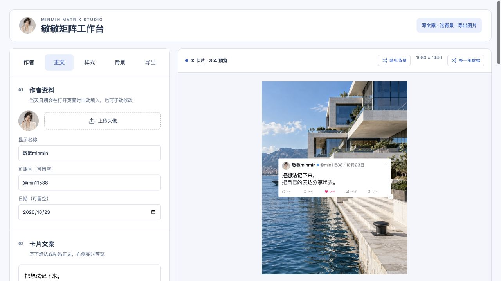

# 敏敏矩阵工作台

当前版本：v1.2.1 · [GitHub 完整包](downloads/minmin-matrix-studio-1.2.1.zip?raw=true) · [下载校验](website/release.json)

把自己的文字、头像与背景，做成想分享的图文卡片。

[在线体验](https://tools.minmin11538.cn/cards/) · [下载安装](https://tools.minmin11538.cn/matrix/) · [安装说明](https://tools.minmin11538.cn/matrix/install.md)



## 交给你的 Agent

把下面这句话发给能联网、下载文件并执行本机命令的 Agent：

> 请打开 https://tools.minmin11538.cn/matrix/，读取 install.md 和 release.json，下载并校验敏敏矩阵工作台完整包。网页读取失败时，用命令行 HTTPS 获取这两个文件。读取包内 minmin-matrix-studio/SKILL.md，检查本机依赖并完成安装、启动；使用我自己的作者资料，帮我导出一张测试 PNG 并检查尺寸。已有安装先检查版本，保留我的个人配置和作品。

完整发行包已带构建好的应用，正常运行只需要 Node.js 22.13+，不需要 Python、npm 安装或模型 API key。没有 Node 时让 Agent 从官方渠道安装并验证。用户自己的账号、头像和正文由用户配置。

安装后的启动命令：

```sh
cd minmin-matrix-studio
node scripts/start.mjs
```

打开启动助手输出的本机地址。助手自动选择空闲端口，页面仅监听本机。停止时结束该进程；默认不配置系统开机启动。

## 可以做什么

- X、微博、朋友圈卡片，背景竖图或纯卡片 PNG 导出。
- 编辑名称、头像、账号和日期；左侧连续编辑，右侧实时预览。
- 224 张敏敏委托生成的背景，按场景筛选、搜索、随机选图。
- 每页 12 张缩略图，提前加载下一页；点选只读取对应的高质量 WebP。
- 上传自己的图片，调整卡片位置、大小、背景亮度、字号和透明度。

互动数字是模拟展示值，不是平台实际数据。没有素材采集、固定改写模板、飞书接口或自动发帖。编辑内容不自动保存，刷新前请及时导出。自动填写网页和导出需要 Agent 有浏览器控制能力；没有时可由 Agent 启动，用户直接编辑。

## 从源码运行

```sh
cd app
npm ci
npm run build
npm run build:server
cd ..
node scripts/start.mjs
```

完整包与源码使用同一应用版本；只有更新缩略图时才需要 Python/Pillow。`npm run build:thumbnails` 重新生成缩略图。依赖版本固定在 package-lock.json 中。

## 验证范围

首版在 macOS 上验证：无 node_modules 的完整 ZIP 解压目录启动、不同端口并行运行、分类与分页、随机选择、背景加载及 PNG 导出。Windows/Linux 的启动助手使用跨平台 Node API，但尚未实机验收，不声称全平台已经验证。

## 来源与许可

代码基于 [dontbesilent Tweet Card Studio](https://github.com/line-cell/dontbesilent-tweet-card-studio) 改编，保留 line-cell 原始 MIT 版权声明。敏敏版调整连续编辑布局、多平台卡片、图库与默认视觉，移除了文案库及固定改写模板。

本版不带上游原有图库，仅带敏敏委托 imagegen 生成并逐张对应核验的 224 张底图。图片使用说明见 [ASSET-LICENSE.md](ASSET-LICENSE.md)，来源与原始/发行版哈希见 [图片来源清单](app/public/gallery-provenance.json)。生成图不表示真实地点实拍或第三方品牌授权。原有代码继续遵循 [MIT LICENSE](LICENSE)；本版新增署名内容的适用范围见 [COPYRIGHT.md](COPYRIGHT.md)，打包依赖声明见 [THIRD_PARTY_NOTICES.md](THIRD_PARTY_NOTICES.md)。

## 来源署名与许可范围

本次新增的原创署名内容采用 [敏敏工具来源署名许可](BRAND-LICENSE.md)，详见 [版权范围](COPYRIGHT.md)。保留适用的项目来源署名和链接；第三方与旧版 MIT 权利不变。用户生成图片、笔记和飞书文档不加水印。

品牌官网尚待建设，暂用本项目已上线的介绍页；[官网待补记录](FOLLOW_UP.md)。
